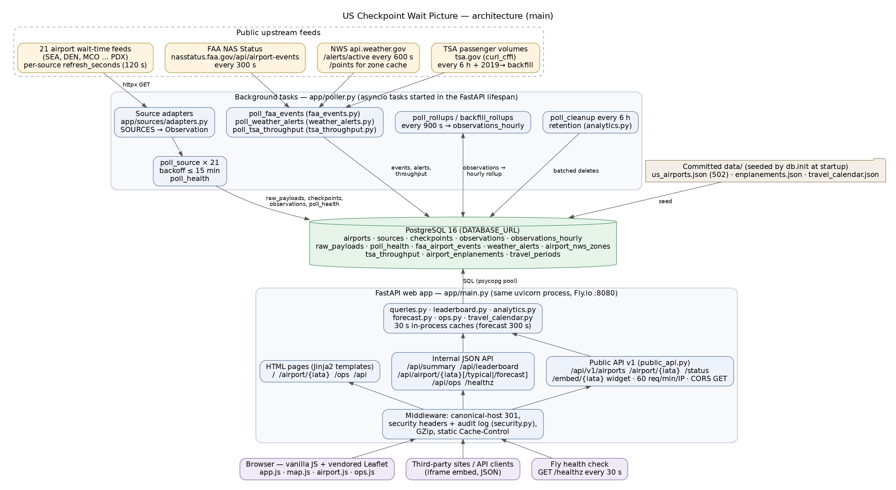

# Architecture

How US Checkpoint Wait Picture works on `main` today: one Python 3.12 process
(FastAPI under uvicorn, deployed as the Fly.io app `checkpoint-wait-picture` on
port 8080) that both polls public feeds in background asyncio tasks and serves
the website and JSON APIs, backed by one PostgreSQL 16 database.

The diagram source is [`diagrams/architecture.dot`](diagrams/architecture.dot)
(Graphviz). After editing it, run `docs/diagrams/render.sh` to regenerate
`architecture.png` and `architecture.svg`, and commit all three.

## Process lifecycle

`app/main.py` defines a FastAPI `lifespan` that runs, in order:

1. `db.init()` (`app/db.py`): open the psycopg async connection pool from
   `DATABASE_URL`, create or migrate the schema, and seed the committed data
   files: `data/us_airports.json` (502 airports) into `airports`,
   `data/enplanements.json` into `airport_enplanements`, and
   `data/travel_calendar.json` into `travel_periods` (full replace).
2. `poller.start()` (`app/poller.py`): register every source in `sources`, open
   one shared `httpx.AsyncClient` with an honest user agent, and start the
   background tasks below.

On shutdown it cancels the tasks, closes the HTTP client, then closes the pool.
The web app cannot start without a database connection.

## Background tasks (`app/poller.py`)

| Task | Module | Schedule | Writes |
|---|---|---|---|
| `poll_source` (one per entry in `SOURCES`, 21 today) | `app/sources/adapters.py` | each source's `refresh_seconds` (120 s default); exponential backoff on failure, capped at 15 min | `raw_payloads`, `checkpoints`, `observations`, `poll_health` |
| `poll_faa_events` | `app/faa_events.py` | every 300 s | `faa_airport_events`, `raw_payloads`, `poll_health` (`FAA-NAS`) |
| `poll_weather_alerts` | `app/weather_alerts.py` | every 600 s | `weather_alerts`, `airport_nws_zones`, `raw_payloads`, `poll_health` |
| `poll_tsa_throughput` | `app/tsa_throughput.py` | every 6 h (30 min retry after a failure) | `tsa_throughput` |
| `backfill_tsa_throughput` | `app/tsa_throughput.py` | once at startup, 2019 through last completed year | `tsa_throughput` |
| `poll_rollups` / `backfill_rollups` | `app/analytics.py` | every `ROLLUP_INTERVAL_SECONDS` (900 s); backfill once at startup | `observations_hourly` |
| `poll_cleanup` | `app/analytics.py` | every `CLEANUP_INTERVAL_SECONDS` (6 h) | batched deletes from `observations`, `raw_payloads`, `faa_airport_events`, `weather_alerts` |

### Airport wait-time sources

`SOURCES` in `app/sources/adapters.py` is the single source of truth: each
`Source` (`app/sources/base.py`) has a code, name, public URL, attribution,
refresh rate, and a `fetch` coroutine. A fetch returns a `FetchResult` with the
raw payload (stored for provenance) and a list of `Observation`s: checkpoint
name, lane type (`standard`, `precheck`, `other`), wait in seconds, open flag,
and the source's publish time when it has one. A poll that returns no
observations counts as a failure.

### FAA airport events (`app/faa_events.py`)

Fetches the FAA NAS Status airport-events feed
(`nasstatus.faa.gov/api/airport-events`), parses ground stops, delay programs,
closures (including daily `DLY hhmm-hhmm` closures) and their times, and stores
them per airport. Airport pages show an FAA banner; `/ops` shows the feed's
health.

### NWS weather alerts (`app/weather_alerts.py`)

One national `api.weather.gov/alerts/active` request per cycle. Each airport's
NWS forecast, county and fire zones are resolved via `/points` (at most 150
airports per cycle, cached 90 days in `airport_nws_zones`); alerts are matched
by zone, with a point-in-polygon fallback for alerts that carry geometry. Only
event types in `RELEVANT_EVENTS` are kept.

### TSA throughput and enplanements

`app/tsa_throughput.py` scrapes national daily passenger volumes from
tsa.gov with `curl_cffi`. `app/enplanements.py` loads the committed FAA
enplanements file (regenerated with `scripts/fetch_enplanements.py`) and maps
FAA LOCIDs to IATA codes.

### Rollups and retention (`app/analytics.py`)

Rollups re-aggregate the last `ROLLUP_LOOKBACK_HOURS` (3) of `observations`
into one `observations_hourly` row per checkpoint, lane and UTC hour. Cleanup
deletes in batches of `CLEANUP_BATCH_LIMIT` with the retention windows
`RETENTION_RAW_PAYLOAD_DAYS` (3), `RETENTION_OBSERVATION_DAYS` (30),
`RETENTION_FAA_EVENT_DAYS` (180) and `RETENTION_WEATHER_ALERT_DAYS` (180). All
are environment-overridable; see [RUNBOOK.md](../RUNBOOK.md).

## Web layer (`app/main.py`)

Every request passes through middleware that, in order of effect:

- redirects legacy hosts (`tsadelays.com`, `www.tsadelays.com`) to
  `waitpicture.com` with a 301;
- applies `app/security.py`: security headers and CSP (a separate frameable
  CSP for `/embed/*`), IATA whitelist validation, client-IP attribution, and
  structured JSON audit logs;
- gzips responses over 500 bytes and sets `Cache-Control` on `/static`;
- turns unhandled exceptions into a generic error body.

### Pages (Jinja2 templates in `app/templates/`, JS in `app/static/`)

| Route | Template | Browser script | Data it loads |
|---|---|---|---|
| `/` | `index.html` | `app.js`, `map.js` (vendored Leaflet + `us-states.json`, no tile servers) | `/api/summary`, `/api/leaderboard` |
| `/airport/{iata}` | `airport.html` | `airport.js` | `/api/airport/{iata}`, `/forecast`, `/typical` |
| `/ops` | `ops.html` | `ops.js` | `/api/ops` |
| `/api` | `api_docs.html` | — | public API documentation |
| `/embed/{iata}` | built by `public_api.embed_response` | — | iframe widget for third-party sites |

### Internal JSON API

| Route | Built by | Notes |
|---|---|---|
| `/api/summary` | `queries.summary_airports` | all 502 airports with live flag and latest standard/PreCheck waits, live/no-data counts, national TSA throughput, active FAA events, travel period; 30 s cache |
| `/api/leaderboard` | `app/leaderboard.py` | worst standard and PreCheck waits (fresh within 30 min, top 10) and most improved vs. 3 h ago; 30 s cache |
| `/api/airport/{iata}` | `queries.airport_detail` + `app/analytics.py` | checkpoints (with stale flag), recent history, weather alerts, FAA events, enplanements, travel period, and the typical wait for the current hour |
| `/api/airport/{iata}/typical` | `app/analytics.py` | standard-lane wait percentiles by UTC hour of week from `observations_hourly`; 30 s cache |
| `/api/airport/{iata}/forecast` | `app/forecast.py` | 30/60/120-minute standard-lane forecast blending the recent trend with an hour-of-week profile (`blend`), or `trend_only` / `profile_only` when one input is missing or too thin; 300 s cache |
| `/api/ops` | `app/ops.py` | per-source green/amber/red health, backoff estimate, row counts, last rollup/cleanup, DB size |
| `/healthz` | `queries.source_health` | Fly health check (every 30 s); `ok` only when every source is healthy |

### Public API v1 (`app/public_api.py`)

A separate FastAPI app mounted at `/api/v1`: `/airports`, `/airport/{iata}` and
`/status`. It allows cross-origin `GET` from any origin and rate-limits each
client IP to 60 requests per 60 s (tracking at most 10,000 clients), returning
`429` with `Retry-After`.

## Storage (`app/db.py`)

| Table | Holds |
|---|---|
| `airports` | seeded airport list (IATA, name, city, state, lat/lon, hub size) |
| `sources` | registered feeds and their attribution/refresh rate |
| `checkpoints` | checkpoints discovered per airport |
| `observations` | one row per checkpoint lane per poll: wait, open flag, publish and fetch times, raw payload reference |
| `observations_hourly` | hourly rollups used for "typical" and forecasts |
| `raw_payloads` | raw upstream responses for provenance |
| `poll_health` | last success/attempt/error and consecutive failures per source |
| `faa_airport_events` | FAA NAS events per airport |
| `weather_alerts`, `airport_nws_zones` | matched NWS alerts and cached zone lookups |
| `tsa_throughput` | national daily passenger counts |
| `airport_enplanements` | FAA annual enplanements per airport |
| `travel_periods` | seeded travel-demand calendar |

## Build, test and deploy

- `.github/workflows/ci.yml` runs `ruff check .`, `mypy` and `python -m pytest`
  on Python 3.12. Tests use recorded fixtures and never touch the network or a
  database.
- `.github/workflows/fly-deploy.yml` deploys to Fly.io (`fly.toml`,
  `Dockerfile` on `python:3.12-slim`) after CI succeeds on `main`.
